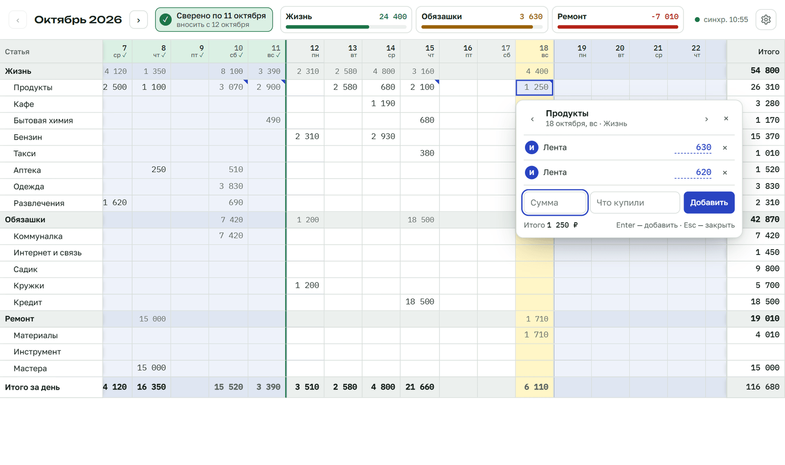
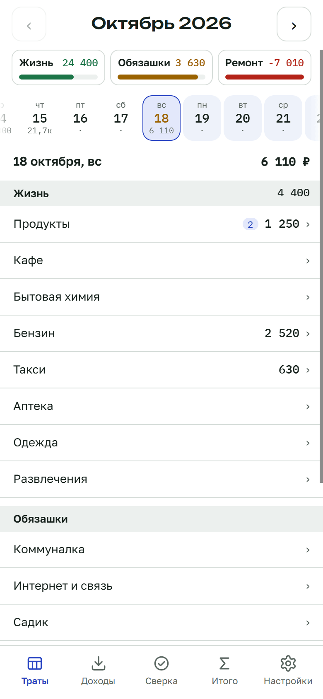
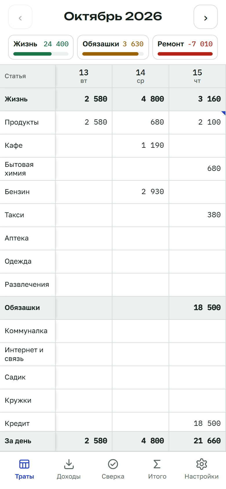
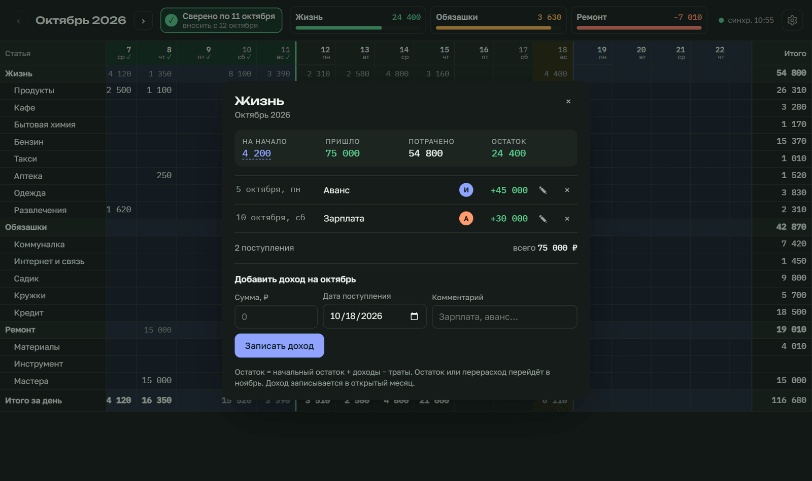

# Семейный бюджет

Домашняя бухгалтерия на несколько человек: траты по статьям и дням в виде таблицы на месяц, как в Google Таблицах, только удобнее. Работает в браузере, на Windows и на Android. Все устройства синхронизируются через ваш собственный небольшой сервер. Без интернета приложение работает как обычно и досылает изменения, когда сеть появляется.



<p align="center">
  
  &nbsp;
  
</p>



*Данные на скриншотах выдуманные.*

## Возможности

- **Таблица месяца:** статьи по строкам, дни по столбцам, итоги за день и за месяц. Нажатие на ячейку показывает траты этого дня: кто внёс, комментарий, сумма. Их можно исправить или удалить.
- **Группы статей с остатком:** остаток = остаток прошлого месяца + доходы − траты. Плюс и минус переходят в следующий месяц.
- **Доходы** записываются в группу и месяц.
- **Сверка:** отмечаете день, по который всё внесено и сошлось с реальными деньгами, и видно, с какого числа вносить дальше.
- **Статьи и группы меняются с выбранного месяца,** прошлые месяцы остаются как были.
- **Совместная работа:** у каждого свой логин, правки видны на всех устройствах.
- **На телефоне** траты показываются по дням или таблицей на три дня, вид выбирается в настройках.
- **Светлая и тёмная тема.**
- **Резервные копии** на устройстве: автоматические и ручные, сохранение в файл, восстановление.

## Скачать

| Платформа | Файл |
|---|---|
| Windows 10/11 | [buh-windows-x64-setup.exe](https://github.com/amkmonk/buh/releases/latest/download/buh-windows-x64-setup.exe) |
| Android 7+ | [buh-android.apk](https://github.com/amkmonk/buh/releases/latest/download/buh-android.apk) |
| Браузер | откройте адрес своего сервера |

Все версии — на странице [Releases](https://github.com/amkmonk/buh/releases).

- **Windows** может предупредить о неизвестном издателе: «Подробнее» → «Выполнить в любом случае».
- **Android** попросит разрешить установку из этого источника. Обновления ставятся поверх, данные сохраняются.

При первом запуске приложение спросит адрес сервера, логин и пароль.

## Свой сервер

Серверу нужно совсем немного: Linux с systemd, около 20 МБ памяти и доля процессора. Подойдёт самый дешёвый VPS, домашний компьютер или Raspberry Pi. Сервер можно ставить рядом с другими службами: он занимает только свои порты и не трогает остальное.

### 1. Домен

Для работы через интернет нужен домен: по нему сервер получит бесплатный сертификат HTTPS. Подойдёт бесплатный поддомен [DuckDNS](https://www.duckdns.org):

1. Войдите через GitHub или Google.
2. Придумайте имя, например `my-budget`.
3. Укажите IP-адрес сервера и нажмите «update ip».

Получится домен вида `my-budget.duckdns.org`.

### 2. Установка

На сервере выполните две строки. **В первой замените `my-budget.duckdns.org` на свой домен из шага 1.**

```sh
DOMAIN=my-budget.duckdns.org
curl -fsSL https://raw.githubusercontent.com/amkmonk/buh/main/deploy/install.sh | sudo bash -s -- --domain $DOMAIN
```

Скрипт скачает сервер, запустит его как службу и создаст первого пользователя. Логин и пароль он покажет в конце.

Приложение будет доступно по адресу `https://my-budget.duckdns.org:8443`. Откройте его в браузере или укажите в приложении на экране входа.

Порт 80 должен быть свободен и открыт: через него сервер получает и продлевает сертификат. Сам сервер работает на 8443.

| Параметр | Что делает |
|---|---|
| `--port 9443` | другой порт приложения, если 8443 занят |
| `--login ivan` | логин первого пользователя (по умолчанию `admin`) |
| `--no-https` | без домена и сертификата, только для домашней сети |
| `--version v1.0.0` | конкретная версия вместо последней |

**Обновление** — та же команда. Данные и настройки сохраняются.

### 3. Пользователи

Добавлять пользователей и менять пароли удобнее в приложении: шестерёнка → «Пользователи». Из командной строки сервера:

```sh
B="sudo runuser -u buh -- env BUH_DB=/var/lib/buh/buh.db /opt/buh/buh-server"
$B user list
$B user add maria "Мария" пароль123
$B user passwd admin новый-пароль
```

### Docker

Если удобнее Docker, соберите и запустите контейнер из исходников:

```sh
git clone https://github.com/amkmonk/buh.git && cd buh
BUH_ADMIN_PASSWORD=придумайте-пароль docker compose up -d --build
```

Сервер будет на `http://адрес:8080`, первый пользователь — `admin`. Для доступа через интернет поставьте перед ним прокси с HTTPS (Caddy, nginx).

## Сохранность данных

- **Каждое устройство хранит книгу целиком.** Если сервер пропадёт, поставьте новый и войдите с любого устройства: приложение само выгрузит туда всю историю.
- **Резервные копии на устройстве:** автоматическая раз в сутки (хранятся три последние) и ручные. Копию можно сохранить в файл и восстановить, добавив недостающее или полностью заменив книгу.
- **Снимки на сервере:** раз в сутки сервер сохраняет копию базы в `/var/lib/buh/backups` и хранит семь последних.

## Для разработчиков

```
app/      клиент: React + TypeScript + Vite, данные в IndexedDB
  src-tauri/   оболочка Windows (Tauri)
  android/     оболочка Android (Capacitor)
server/   сервер: Go + SQLite, синхронизация и вход
deploy/   установка сервера
```

```sh
cd server && go run .                  # сервер на :8080
cd app && npm install && npm run dev   # клиент на :5173
cd server && go test ./...             # тесты сервера
```

- **Сборка приложений:** `npm run win:build` (нужны Rust и Visual Studio Build Tools) и `npm run android:build` (нужны JDK 21 и Android SDK).
- **Релизы** собирает GitHub Actions по тегу `vX.Y.Z`. Для подписи APK в форке добавьте секреты `ANDROID_KEYSTORE_BASE64`, `ANDROID_KEYSTORE_PASSWORD` и `ANDROID_KEY_ALIAS`.
